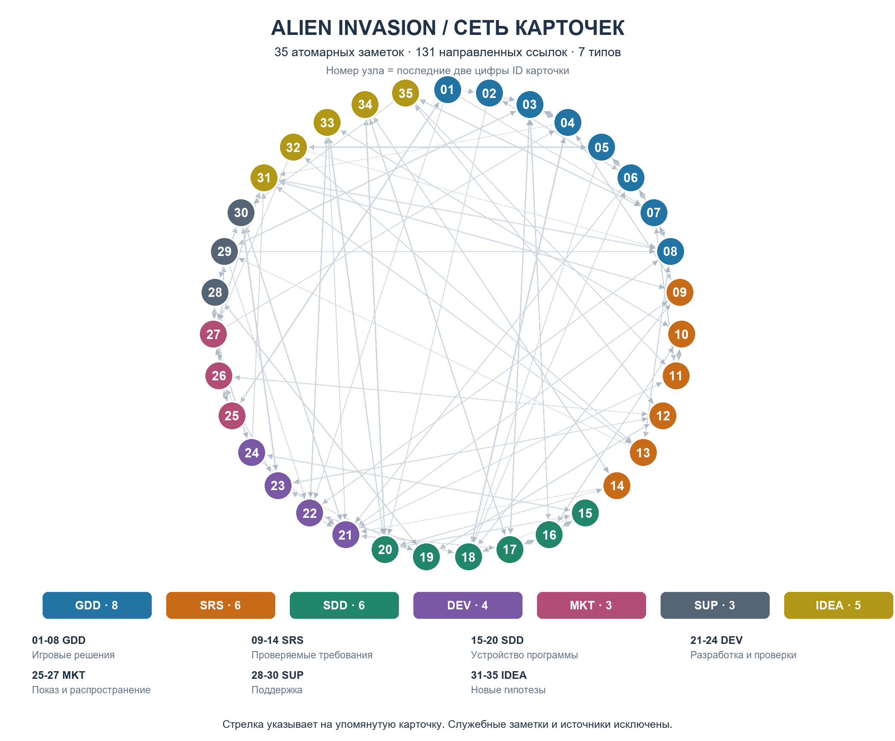
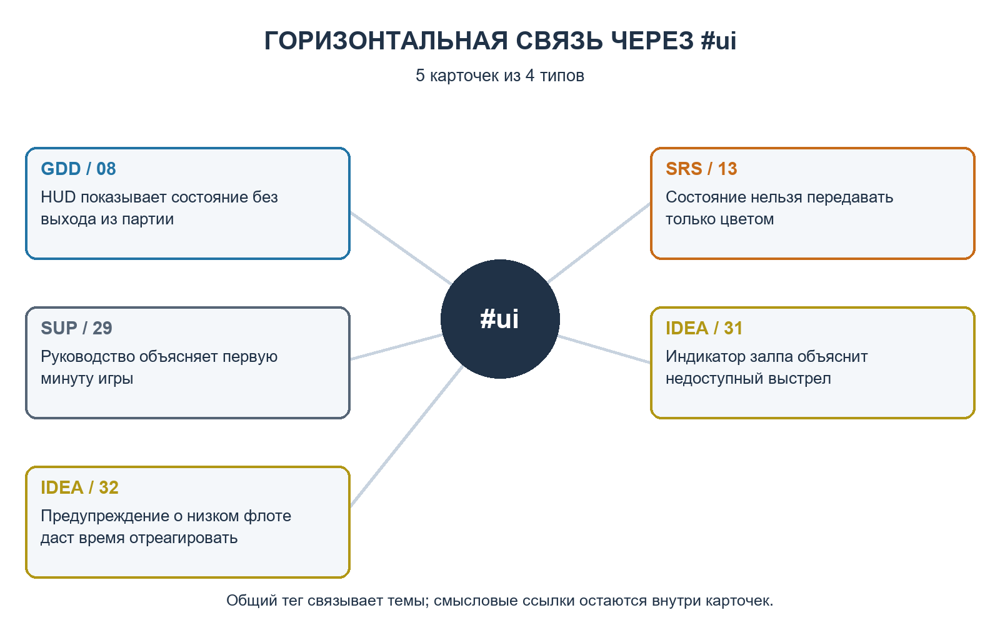

# Практическая работа: основы Zettelkasten

## Сеть знаний о разработке Alien Invasion

Тоц Леонид Александрович · группа ИВТ-2

Системы и технологии подготовки технической и издательской документации

РГПУ им. А. И. Герцена · Санкт-Петербург · 21 октября 2026 г.

### Цель работы

Организовать знания о разработке игры в виде небольших атомарных карточек, связать их по смыслу, выделить новые идеи и собрать из сети материалы технической документации.

### Исходные данные и выбор темы

Использовано задание Дмитрия Власова «Практическая работа #2 - Основы Zettelkasten» и уточнение преподавателя о сети небольших карточек. Тема выбрана по существующим материалам проекта Alien Invasion: GDD/SRS/SDD ЛР5 и реализация Python/Pygame ЛР6. Номер новой папки не назначался, поскольку в репозитории уже есть ЛР2 с другой темой.

### Полученный результат

Подготовлены 35 предметных карточек семи типов, 4 служебные заметки, пять карточек новых идей, два графа, семь отдельных документов Markdown, этот отчёт и архив для передачи. Хранилище не требует облачного сервиса или сторонних плагинов.

### Статусы утверждений

«Подтверждено кодом» означает чтение реализации ЛР6. «Проектное требование» относится к документам ЛР5. «Гипотеза» обозначает ещё не реализованное и не проверенное с игроками предложение. Новые замеры производительности и прогон игры в этой работе не выполнялись.

---PAGE---

## 1. Организация хранилища

Все предметные карточки лежат плоско в vault. Иерархическое оглавление находится в заметке «Старт», а типы GDD/SRS/SDD/DEV/MKT/SUP/IDEA задают точки зрения на предмет. Папки sources и attachments содержат основания и изображения, а не иерархию карточек.

| Тип | Карточек | Содержание |
| --- | --- | --- |
| GDD | 8 | Цель, цикл, движение, залп, флот, уровни, рекорд, HUD |
| SRS | 6 | Лимит пуль, состояние, повтор, офлайн, читаемость, FPS |
| SDD | 6 | Контроллер, ввод, координаты, коллизии, ресурсы, кадр |
| DEV | 4 | Проверки, расхождения, поставка, порядок разработки |
| MKT | 3 | Показ, распространение, получение отзывов |
| SUP | 3 | Дефекты, руководство, выпуск исправления |
| IDEA | 5 | Новые предложения и критерии проверки |

### Пример атомарной карточки

ID: 20261021000009. SRS - Четвёртая активная пуля не создаётся.

Одна мысль: в активной партии существует не более трёх пуль, а удаление пули освобождает слот. Теги: #SRS #requirements #mechanics. Основания: SRS ЛР5, обработчик выстрела и тесты ЛР6.

Ссылки связывают требование с игровой причиной ограничения (04), обработкой попаданий (18), проверкой правила (21) и идеей индикатора (31). Каждая ссылка сопровождается пояснением, зачем переходить к другой карточке.

### Идентификаторы и редактирование

14 цифр состоят из даты 20261021 и порядкового номера. Это постоянный адрес, а не журнал фактического времени создания. Изменение формулировки не требует нового ID; независимая мысль получает отдельную карточку. Числовые имена и ссылки вида [[20261021000009]] подходят для открытия в Obsidian и настройки ID в Zettlr.

---PAGE---

## 2. Граф смысловых связей

Каждый номер на графе соответствует последним двум цифрам ID карточки. Цвет задаёт её тип. Рёбра построены автоматически из реальных ссылок, стрелка направлена к упомянутой карточке. Служебные заметки и снимки исходных материалов исключены.

Граф содержит 131 направленных ссылок между 78 парами карточек; 101 ссылок проходят между разными типами. Изолированных предметных заметок нет. Сеть имеет одну компоненту связности. Полноразмерные PNG и SVG находятся в vault/attachments; подписи всех узлов доступны в «Старт» и output/cards.csv.

---PAGE---

## 3. Теги и пересмотр

Тег #ui объединяет 5 карточек из GDD, SRS, SUP и IDEA. Это горизонтальная подборка интерфейса: HUD, доступность показателей, первое знакомство, индикатор залпа и предупреждение. Она дополняет объяснённые ссылки внутри карточек.

### Проверка подборок

Автоматически сопоставлены списки файлов для #ui (5), #mechanics (7), #performance (4) и #idea (5). В «Теги-проекта» сохранены явные списки результатов, с которыми можно сравнить поиск редактора.

### Выполненный пересмотр

Сверка ЛР5 и ЛР6 выявила разный смысл запаса кораблей: три жизни в проекте и три замены сверх текущего корабля в коде. В карточке 22 различие выделено явно. Карточка 18 отдельно описывает уничтожение нескольких перекрывающихся целей одной пулей. В карточке 29 указана фактическая клавиша выхода Q вместо проектного Esc. Эти выводы не меняют исходные ЛР.

---PAGE---

## 4. Новые идеи из связей

Ниже приведены гипотезы, полученные при сопоставлении уже существующих карточек. Они не объявляются реализованными функциями.

### 31. Индикатор залпа

Связка 09 -> 08 -> 13: ограниченные пули, постоянный HUD и представление помимо цвета. Предложение: три сегмента и число свободных слотов. Проверка: сегменты соответствуют числу активных пуль; игрок понимает причину отказа в выстреле.

### 32. Предупреждение о низком флоте

Связка 05 -> 08 -> 13: приближение угрозы, обратная связь и читаемость. Предложение: значок и текст при пересечении согласованной опасной высоты. Проверка: правильное включение и сброс предупреждения, затем оценка полезности порога с игроками.

### 33. Неблокирующее восстановление

Связка 20 -> 10 -> 22: обработка кадра, запрет действий и расхождение проекта с кодом. Предложение: RECOVERING с таймером вместо sleep(0.5). Проверка: выход во время восстановления работает, запас повторно не списывается, управление возвращается один раз.

### 34. Временной шаг движения

Связка 14 -> 17 -> 20: нестабильный FPS, дробная позиция и цикл. Предложение: скорости в пикселях за секунду, умноженные на dt. Проверка: одинаковое перемещение за секунду при шагах 1/30 и 1/60 в заданной погрешности; большой dt требует отдельной защиты коллизий.

### 35. Сохранение рекорда

Связка 07 -> 11 -> 12: рекорд процесса, повторная партия и офлайн-режим. Предложение: локальный JSON. Проверка: сохранение после перезапуска, отсутствие сброса при Play и безопасный старт с повреждённым файлом.

### Интеграция в документы

В docs созданы отдельные GDD.md, SRS.md, SDD.md, DEV.md, MKT.md, SUP.md и IDEA.md. Каждый документ собран из соответствующих карточек с обычными Markdown-ссылками. Так сеть используется для подготовки связного материала и сохраняет адреса исходных мыслей.

---PAGE---

## 5. Проверка и воспроизведение

Скрипт scripts/build.py проверил фактические файлы хранилища. Машиночитаемый результат сохранён в output/validation.json, список рёбер - в output/edges.csv. Граф и документы строятся из того же набора карточек.

| Проверка | Результат |
| --- | --- |
| Предметные карточки / минимум задания | 35 / 15 |
| Уникальность ID и соответствие имён | Выполнено |
| Минимальное число тегов на заметку | 2 |
| Минимум исходящих / входящих связей | 3 / 1 |
| Неразрешённые внутренние ссылки | 0 |
| Изолированные предметные карточки | 0 |
| Компоненты связности | 1 |
| Новые идеи / документы Markdown | 5 / 7 |

### Открытие и проверка в редакторе

В Obsidian открыть vault как хранилище, затем «Старт». Для графа выбрать Graph view, фильтр -path:sources исключит исходники; Tags покажет общие теги. В Zettlr добавить vault как рабочую папку и настроить распознавание ID из 14 цифр. Проверить переход из карточки 09 к 31 и подборку #ui. Дополнительные плагины не нужны.

Для повторной проверки из папки Zettelkasten: python scripts/build.py --validate-only. Полная сборка: python scripts/build.py; для неё нужны Pillow, ReportLab и pypdf. Сборка не меняет карточки. Архив содержит всё необходимое для чтения и проверки файлов на другом компьютере.

### Границы выполненной работы

Подготовка файлов, графов и автоматическая проверка выполнены. Установка и открытие Obsidian/Zettlr, проверка поиска в их интерфейсе и снимок живого графа не выполнялись. Готовый статический граф является собственным представлением реальных ссылок и не выдаётся за снимок приложения.

По выбору пользователя результат оставлен локально в папке и полном ZIP-архиве. Пункт PDF о коммите в новом удалённом репозитории не выполнялся: удалённый репозиторий не создавался, коммит и push не выполнялись.

### Вывод

Плоское хранение атомарных мыслей и объяснённые перекрёстные ссылки позволили связать игровой дизайн, требования, код и поддержку. Практический результат работы с сетью - пять проверяемых предложений и явное обнаружение расхождений между проектом и реализацией.

---PAGE---

## 6. Использованные материалы

### Задание и метод

1. Дмитрий Власов. Практическая работа #2 - Основы Zettelkasten. 2024. 11 с. PDF, переданный пользователем. Требования к атомарности, связям, тегам, графу и итоговым документам использованы при подготовке результата.

2. Zettelkasten: как один немецкий учёный стал невероятно продуктивным. Хабр, 29.06.2020. Перевод статьи David B. Clear. Дополнительный материал преподавателя: https://habr.com/ru/articles/508672/

3. Официальный сайт Zettlr. Поддержка ID, внутренних ссылок, тегов и графа: https://www.zettlr.com/

4. Obsidian Help. Internal links: https://help.obsidian.md/Linking+notes+and+files/Internal+links

5. Obsidian Help. Graph view: https://help.obsidian.md/Plugins/Graph+view

Онлайн-источники просмотрены 21.10.2026. Объяснения приведены своими словами; исходный учебный PDF не переиздаётся в составе результата.

### Материалы проекта

6. ЛР5/GDD.md, ЛР5/SRS.md, ЛР5/SDD.md - проектная документация игры.

7. ЛР6/README.md и docs/architecture.md - описание фактического учебного проекта и его архитектуры.

8. ЛР6/src/alien_invasion: alien_invasion.py, settings.py, ship.py, game_stats.py, assets.py - источники фактов о поведении, вводе, координатах, рекорде и ресурсах.

9. ЛР6/tests/test_game_rules.py и pyproject.toml - определения проверок и состав зависимостей/поставки. Тесты изучены, повторный запуск в рамках этой работы не выполнялся.

Снимки перечисленных материалов сохранены в vault/sources. Их происхождение указано в служебной заметке «Источники». Исходные папки ЛР5 и ЛР6 не менялись.
